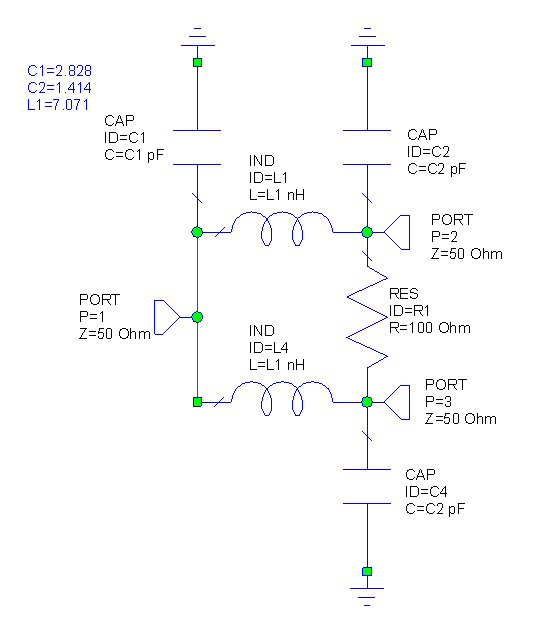
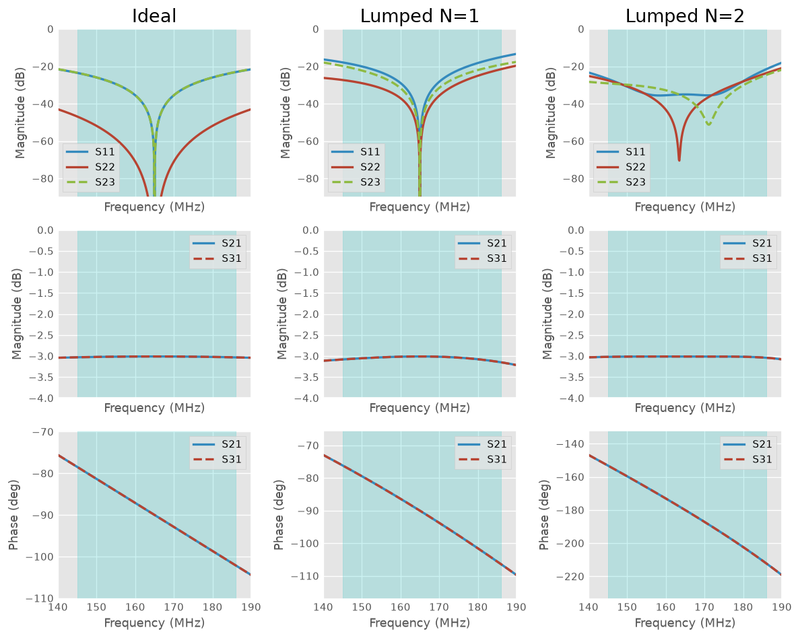
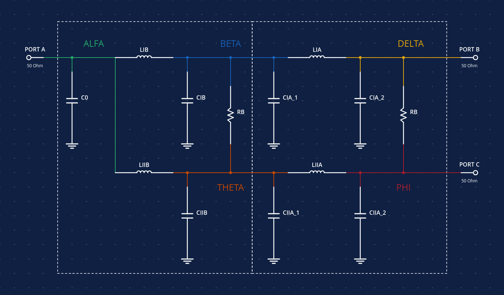

# Wilkinson Power Divider

The core idea is to explore the possibility to implement our own power divider for RF on the VHF band. 

The design draws the inspiration from the microstrip Wilkinson power divider that allows to divide/combine bidirectionally with very good isolation between output ports. 

As on the VHF band the wavelength is comparable to half a meter, the microstrip design becomes cumbersome as it takes a lot of space. An option, is to use the lumped circuit equivalent of the power divider. 

The example circuit shown on the previous figure (thanks to microwaves101) uses a two-branch circuit with inductors, capacitors and a load balancing resistor. When comparing the behavior with the micrstrip version:

The results show that for the single stage equivalent, the isolation/reflections are a little bit higher than the microstrip version. To improve this, and following Cohns results, another stage is added, resulting in a coefficients below the -20 dB limit (self set). 

## Considerations

- VHF band in the range 140MHz - 19MHz. Center on 165MHz. 
- Isolation and reflection parameters lower than -20dB. 

## Circuit analysis

The design for the two-stage lumped Wilkinson divider

The admitance Matrix for the circuit: 

$$ I = Y \cdot V $$

$$
 \left[
    \begin{matrix}
        I_{\alpha} \\
        I_{\beta} \\
        I_{\delta} \\
        I_{\theta} \\
        I_{\phi} \\
    \end{matrix}
 \right]
 = 
 Y \cdot
\left[
    \begin{matrix}
        V_{\alpha} \\
        V_{\beta} \\
        V_{\delta} \\
        V_{\theta} \\
        V_{\phi} \\
    \end{matrix}
\right]
$$

$$ Y = 
    \left[
    \begin{matrix}
        G_{0} + Y_{C0} + Y_{LIB} + Y_{LIIB} & -Y_{LIB} & 0 & -Y_{LIIB} & 0 \\
        -Y_{LIB} & Y_{LIB} + Y_{CIB} + Y_{CIA\_1} + G_{B} + Y_{LIA} & -Y_{LIA} & -G_{B} & 0 \\
        0 & -Y_{LIA} & G_{0} + G_{A} + Y_{CIA\_2} + Y_{LIA} & 0 & -G_{A} \\
        -Y_{LIIB} & -G_{B} & 0 & Y_{LIIB} + Y_{CIIB} + G_{B} + Y_{CIIA\_1} + Y_{LIIA} -Y_{LIIA} \\
        0 & 0 & -G_{A} & Y_{LIIA} & Y_{LIIA} + Y_{CIIA\_2} + G_{A} + G_{0}
    \end{matrix}
    \right]
$$

<!-- The matrix can be reduced considering the following equalities:

$$

$$ -->